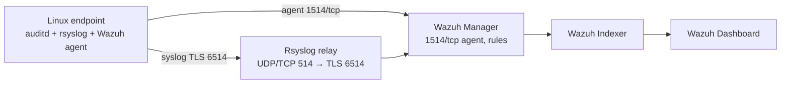

# Enterprise log management: Wazuh, rsyslog, auditd (NIST)

Lab repo for centralized logging: Linux endpoint collection, TLS forwarding, Wazuh detection, and NIST AU traceability.

Controls:

- [NIST SP 800-92](https://csrc.nist.gov/publications/detail/sp/800-92/final) — *Guide to Computer Security Log Management* (generate, store, review, retain).
- [NIST SP 800-53 Rev. 5](https://csrc.nist.gov/publications/detail/sp/800-53/rev-5/final) family **AU** (Audit and Accountability), primarily AU-2, AU-3, AU-6, AU-8, AU-9, AU-12.
- [NIST CSF 2.0](https://www.nist.gov/cyberframework) functions **DE** (Detect) and **RS** (Respond) when alerts enter the SOC process.

IPs, FQDNs, and certificate paths in configs are `PLACEHOLDER.*`. Replace from internal DNS and PKI before deploy. Do not commit production secrets.

Work proceeds in eight sprints. One micro-task at a time. Proof screenshots go under `assets/sprint-X/`.

## Architecture



Each endpoint sends two streams: Wazuh agent (encrypted 1514/tcp) and syslog over TLS 6514. Network devices use `configs/network/rsyslog-network.conf`. The manager evaluates `configs/wazuh/local_rules.xml` and writes JSON alerts to the indexer.

Detail: [docs/01-architecture/README.md](docs/01-architecture/README.md).

## NIST mapping

File-to-control mapping: [docs/02-compliance-nist/README.md](docs/02-compliance-nist/README.md). Local Wazuh rules 100001–100010 cite AU-2, AU-6, and/or AU-12 and a file under `configs/`.

## Layout

| Path | Content |
| --- | --- |
| `.cursorrules` | Language, banned phrases, evidence rules, Mermaid |
| `configs/wazuh/ossec.conf` | Manager/agent: remote, ruleset, localfile, indexer |
| `configs/wazuh/local_rules.xml` | Custom rules 100001–100010 |
| `configs/endpoints/rsyslog.conf` | Endpoint: RFC 3339, omfwd TLS 6514 |
| `configs/endpoints/auditd.rules` | watches on passwd/shadow/sudoers, execve |
| `configs/network/rsyslog-network.conf` | Relay for network devices |
| `scripts/init_project.sh` | Creates missing directories, including `assets/sprint-1`–`8` |
| `scripts/validate_configs.sh` | Layout, XML, banned phrases |
| `docs/03-configuration-guide/` | Install and TLS |
| `docs/04-testing-verification/` | Lab tests and expected hits |
| `docs/05-post-mortem-lessons/` | NTP, decoder faults, noise |
| `assets/sprint-X/` | Sprint proof (required path) |
| `assets/screenshots/` | Legacy capture dirs (raw logs, alerts, dashboards) |

## Commands

```bash
bash scripts/init_project.sh
bash scripts/validate_configs.sh
```

Validator exits 0 when required files exist, `local_rules.xml` parses as XML, and no markdown matches the phrase list in `.cursorrules`.

## Evidence

Where a Dashboard screenshot is required, use an explicit placeholder until the file is stored under `assets/sprint-X/`:

``

Do not invent IPs, timestamps, or rule IDs that are not in `configs/`.
