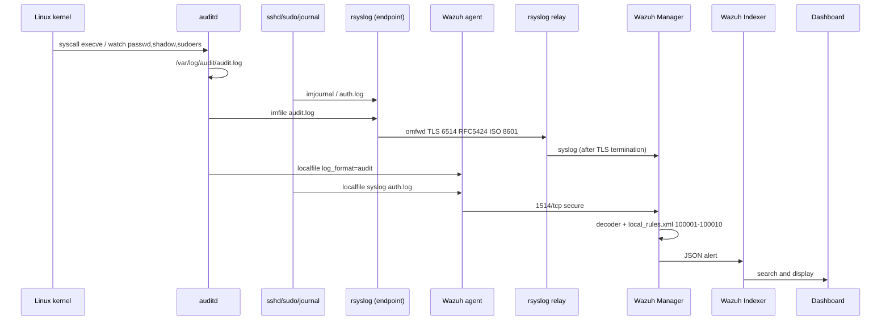

# Architecture

Log pipeline is three layers: source (Linux and network gear), transport (Wazuh agent and rsyslog/TLS), analysis (Manager + Indexer + Dashboard).

## Network topology

RFC 1918 prefixes below are a sketch. Replace from your IPAM. None of these addresses are production.

| Role | Example address | Inbound ports | Note |
| --- | --- | --- | --- |
| Linux endpoint | 10.20.30.41 | — | auditd, rsyslog, wazuh-agent |
| Rsyslog relay | 10.20.40.10 | 514/udp, 514/tcp | `configs/network/rsyslog-network.conf` |
| Wazuh Manager | 10.20.50.11 | 1514/tcp, 514/udp (internal) | `configs/wazuh/ossec.conf` |
| TLS termination / relay out | 10.20.50.11 | 6514/tcp | GnuTLS `omfwd` from endpoint |
| Wazuh Indexer | 10.20.50.12 | 9200/tcp | HTTPS, certs in `ossec.conf` `<indexer>` |
| Wazuh Dashboard | 10.20.50.13 | 443/tcp | alert UI |

Firewall: endpoint → manager 1514/tcp; endpoint → relay or manager 6514/tcp; relay → manager 6514/tcp or 514 after TLS termination. Do not expose 514/udp to the Internet.

## Components

**auditd** (`configs/endpoints/auditd.rules`)  
Kernel syscalls and file watches. Keys `identity`, `sudoers`, `execve` match Wazuh rules 100005–100007.

**Rsyslog on host** (`configs/endpoints/rsyslog.conf`)  
`imuxsock`/`imjournal` plus `imfile` on `/var/log/audit/audit.log`. Template `FwdRFC5424ISO8601` uses `%timestamp:::date-rfc3339%` (ISO 8601). Forward: `omfwd` TCP 6514, `StreamDriver=gtls`, `AuthMode=x509/name`.

**Wazuh agent**  
Reads the same local files listed in `ossec.conf`: `/var/log/auth.log`, `/var/log/syslog` or `/var/log/secure`, `/var/log/audit/audit.log`. Channel 1514/tcp, `connection=secure`.

**Rsyslog relay** (`configs/network/rsyslog-network.conf`)  
Accepts 514 from switches/firewalls, writes `/var/log/network/devices.log`, forwards RFC 5424 over TLS.

**Wazuh Manager**  
`ruleset` points at `etc/rules` where `local_rules.xml` belongs. Alert level is written to file and JSON (`jsonout_output`).

**Indexer / Dashboard**  
Store and search. Index timezone: UTC. Dashboard display timezone: UTC to avoid offset errors (see `docs/05-post-mortem-lessons`).

NIST SP 800-92 maps this to *log generation* (auditd, sshd, sudo), *storage* (local files + indexer), *protection* (TLS, file permissions), *analysis* (rules 100001–100010).

## Log flow

Two ingest paths can duplicate events. In lab: disable `imfile` on audit.log if the agent already reads the file, or filter on the manager with `<white_list>` / rule `no_full_log`. Production choice is documented per host.

## File references

| Function | File | AU |
| --- | --- | --- |
| What is logged | `configs/endpoints/auditd.rules`, `ossec.conf` `<localfile>` | AU-2, AU-12 |
| Content / timestamp | `rsyslog.conf` RFC 3339 | AU-3, AU-8 |
| Analysis | `local_rules.xml` | AU-6 |
| Transport integrity | TLS 6514 in both rsyslog files | AU-9 |
