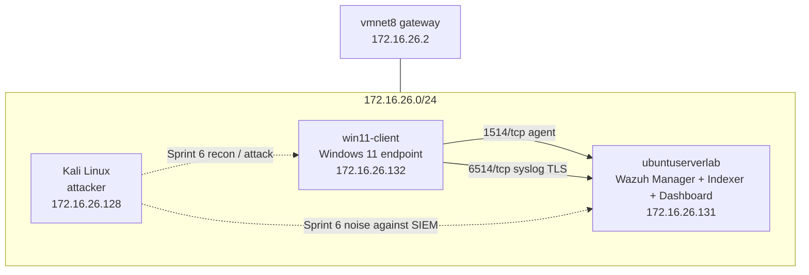
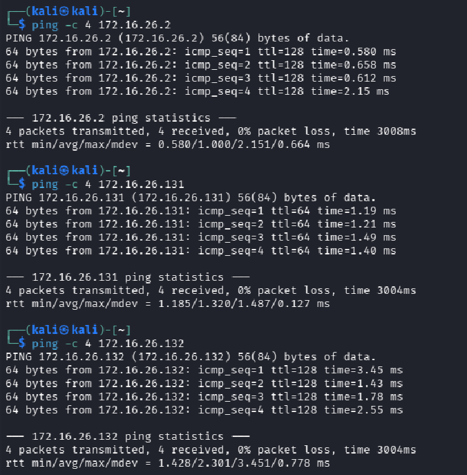
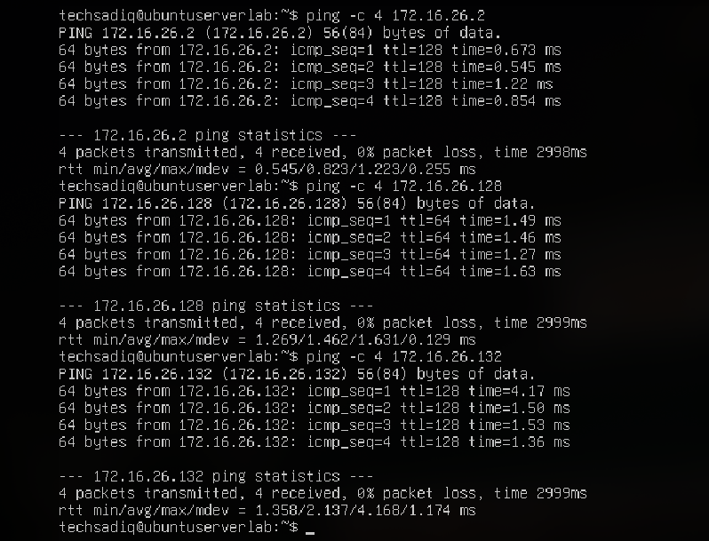
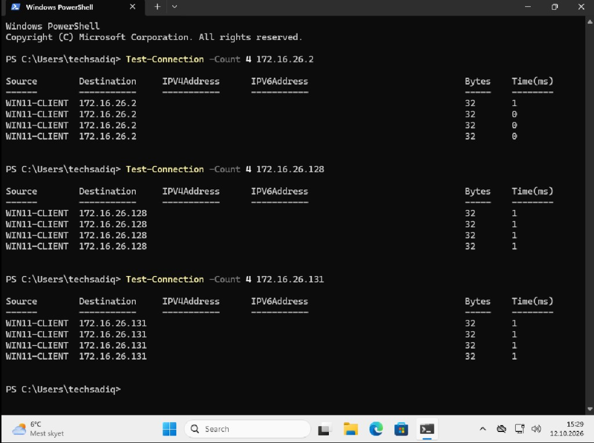
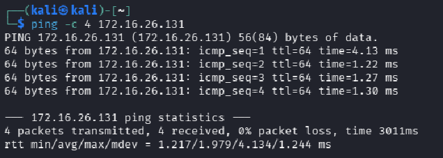
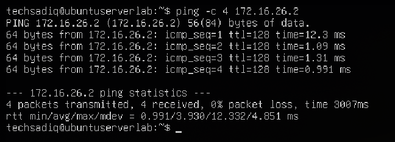
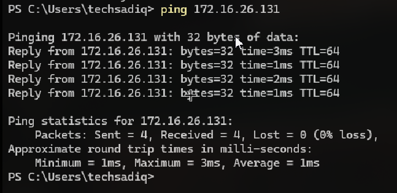
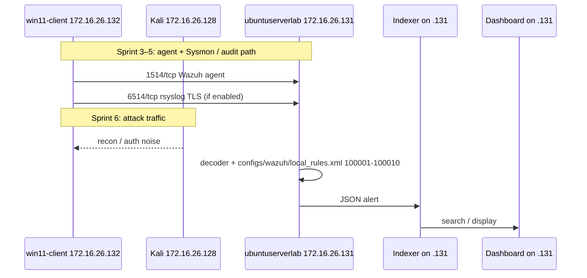

# Architecture — Sprint 2 network baseline

Lab topology on VMware `vmnet8` NAT. Addresses below are verified on the lab hosts. Do not invent additional host IPs.

## IP matrix

| Role | Hostname / node | IPv4 | Subnet / notes |
| --- | --- | --- | --- |
| NAT gateway | VMware vmnet8 gateway | `172.16.26.2` | `172.16.26.0/24` |
| Attacker | Kali Linux | `172.16.26.128` | Red-team node (Sprint 6) |
| SIEM collector | `ubuntuserverlab` (Ubuntu Server) | `172.16.26.131` | Wazuh Manager; Indexer/Dashboard colocated on this host until split |
| Target endpoint | `win11-client` (Windows 11) | `172.16.26.132` | Sysmon / agent target (Sprint 3–5) |

**Ports (lab):**

| Path | Port | Purpose |
| --- | --- | --- |
| Endpoint → SIEM | `1514/tcp` | Wazuh agent (`connection=secure`) — `configs/wazuh/ossec.conf` |
| Endpoint → SIEM | `6514/tcp` | rsyslog TLS (`omfwd` / GnuTLS) — `configs/endpoints/rsyslog.conf` |
| SIEM UI | `443/tcp` | Wazuh Dashboard (on `172.16.26.131`) |
| Indexer | `9200/tcp` | Wazuh Indexer HTTPS (on `172.16.26.131`) |

No separate rsyslog-relay IP is assigned in this lab. Network-device relay config (`configs/network/rsyslog-network.conf`) remains for a future host; do not point it at an invented address.

Do not expose `514/udp` beyond `172.16.26.0/24`.

## Topology



## ICMP reachability validation

Run from each node. Record RTT and packet loss. Save proof under `assets/sprint-2/`.

**From Kali (`172.16.26.128`):**

```bash
ping -c 4 172.16.26.2
ping -c 4 172.16.26.131
ping -c 4 172.16.26.132
```

**From Ubuntu SIEM (`172.16.26.131`):**

```bash
ping -c 4 172.16.26.2
ping -c 4 172.16.26.128
ping -c 4 172.16.26.132
```

**From Windows 11 (`172.16.26.132`) — PowerShell:**

```powershell
Test-Connection -Count 4 172.16.26.2
Test-Connection -Count 4 172.16.26.128
Test-Connection -Count 4 172.16.26.131
```

**Pass criteria:** 0% loss to gateway and to both peer lab hosts. Failure: check VMware NIC on `vmnet8`, guest firewall ICMP, and that all three VMs share `172.16.26.0/24`.

### Full-mesh ICMP matrix (verified)

Each host pings gateway `172.16.26.2` and both peer VMs. Result: 0% loss on all paths.







### Earlier single-path captures







## Log pipeline (roles on this IP set)



Linux-side generation (`auditd`, `sshd`, `sudo`) still maps to `configs/endpoints/auditd.rules` and `configs/endpoints/rsyslog.conf` when a Linux endpoint is added. Windows telemetry is Sprint 3 (Sysmon / GPO).

## NIST mapping

| Function | Lab node / file | Control |
| --- | --- | --- |
| Log generation | `win11-client` (later Sysmon); Linux configs `configs/endpoints/auditd.rules` | NIST SP 800-92 generation; SP 800-53 **AU-2**, **AU-12** |
| Content / timestamps | RFC 3339 in `configs/endpoints/rsyslog.conf` | **AU-3**, **AU-8** |
| Transport / protection | `1514/tcp` + `6514/tcp` TLS to `172.16.26.131` | **AU-9** |
| Analysis / review | `configs/wazuh/local_rules.xml` on `ubuntuserverlab` | **AU-6** |
| Storage | Indexer on `172.16.26.131` | SP 800-92 storage |

## File references

| Function | File | AU |
| --- | --- | --- |
| What is logged | `configs/endpoints/auditd.rules`, `ossec.conf` `<localfile>` | AU-2, AU-12 |
| Content / timestamp | `rsyslog.conf` RFC 3339 | AU-3, AU-8 |
| Analysis | `local_rules.xml` | AU-6 |
| Transport integrity | TLS 6514 in rsyslog configs; agent 1514 | AU-9 |
